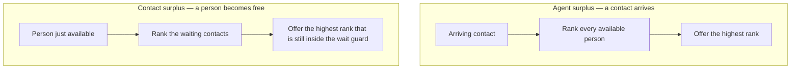
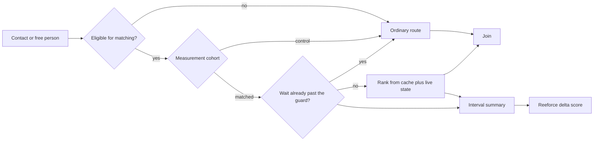
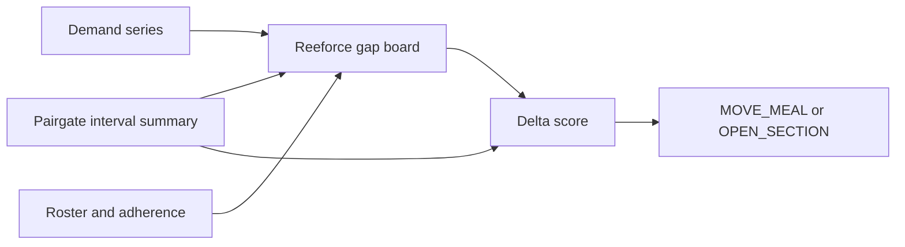

# Pairgate

**Rank the join. Protect the wait.**

Open-source **real-time contact–resource matching**. When a contact arrives, rank the people who are free. When a person becomes free, rank the contacts who are waiting. Ordinary routing (longest idle, next in line) remains the fallback when a contact is ineligible or has waited too long.

Pairgate does not edit the schedule. [Reeforce](https://github.com/vikas-prasad-cx/reeforce) does. Pairgate tells Reeforce which shortage is a missing specialty, not only a missing headcount, so the next meal move or overflow open returns the person the next contacts actually need.

[](LICENSE)

## Why this is not Reeforce

| | Pairgate | Reeforce |
|--|----------|----------|
| Question | Which person should take this contact? | Is the next interval short, and what one schedule edit helps? |
| Clock | One join. Target well under 150 ms, agent-surplus near 70 ms. | Next 15–120 minutes. |
| Actuator | A rank, or a forced ordinary route. | `MOVE_MEAL`, `OPEN_SECTION`, `MOVE_SLOT`, `RETIME_DEMAND`. |
| Unit | One contact and one pool. | One interval on a gap board. |

A headcount gap and a match gap are different shortages. Twenty-four people can be on the floor while only three of them score well for the arrivals in that quarter-hour. Reeforce today would free any meal. Pairgate's interval summary tells it whom to free.

## Two directions



Pools stay small on purpose: on the order of 100–200 available people, or the first 70–100 waiting contacts. Ranking the whole day is a schedule problem, and that stays in Reeforce.

## Decision path



The wait guard is statistical, not a fixed timer:

```text
threshold = mean(wait) + 2 × stdev(wait) + buffer
```

Mean and standard deviation are taken after extreme outliers are removed. The buffer is a policy constant (a common starting point is 60 seconds). A contact past the threshold is marked breached and takes the ordinary route immediately, so out-of-sequence ranking cannot hold someone at the back of the queue forever.

## What the ranker reads

All four inputs are already in a cache when the decision starts. The ranker does not call a profile store or a warehouse on the join path.

| Input | When it changes | Used for |
|-------|-----------------|----------|
| Resource features | Nightly batch | Performance, team, configuration |
| Contact features | Historical profile, fetched into cache before the handoff | Who this contact is |
| Contact-path features | Written during the pre-queue dialogue, before transfer completes | Why this contact is here |
| Live state | Continuous | Who is free, how long each contact has waited |

Lines of work do not share one objective. A care line may weight outcome value highest. A technical line may weight first-contact resolution. A collections line may need its own objective. Weights are owned by the team that builds the model and are changed from daily results, not hard-coded in the router.

Measurement keeps an ordinary-route cohort (a typical split is 80% matched, 20% control) on the same infrastructure, with ranking disabled for the control. Disposition flags make the comparison possible after the fact.

## How Reeforce uses the result



Reeforce still proposes one small edit. The score changes:

- Prefer a meal move that returns a resource with high `coverageScore` for the scarce cohort.
- Treat a rising `breachRate` while the headcount gap looks acceptable as a mix problem, not a count problem.
- Record, in Reeforce's learn step, whether the edit improved matched-cohort outcome or only closed the headcount gap.

The summary schema is [spec/interval-summary.schema.json](spec/interval-summary.schema.json). It carries cohort counts and resource ids already on the Reeforce roster. It does not carry contact profiles or model weights.

## Documents

| Document | What it settles |
|----------|-----------------|
| [Architecture](docs/architecture.md) | Components, the two clocks, the model, and the MCP and Agent2Agent adapters |
| [Decision flow](docs/decision-flow.md) | Both surplus directions, eligibility, cohort, guard |
| [Reeforce contract](docs/reeforce-contract.md) | What Reeforce may read, and how deltas should change |
| [Latency](docs/latency.md) | What is allowed on the join path |
| [Glossary](docs/glossary.md) | Terms shared with Reeforce |

## Non-goals

- Not a workforce-management suite and not a day-ahead roster optimizer.
- Not a forecasting lab.
- Not a multi-tenant hosted product in this repository.
- Not a place for schedule edits. If the change moves a meal, it belongs in Reeforce.

## License

Apache License 2.0 — see [LICENSE](LICENSE).
