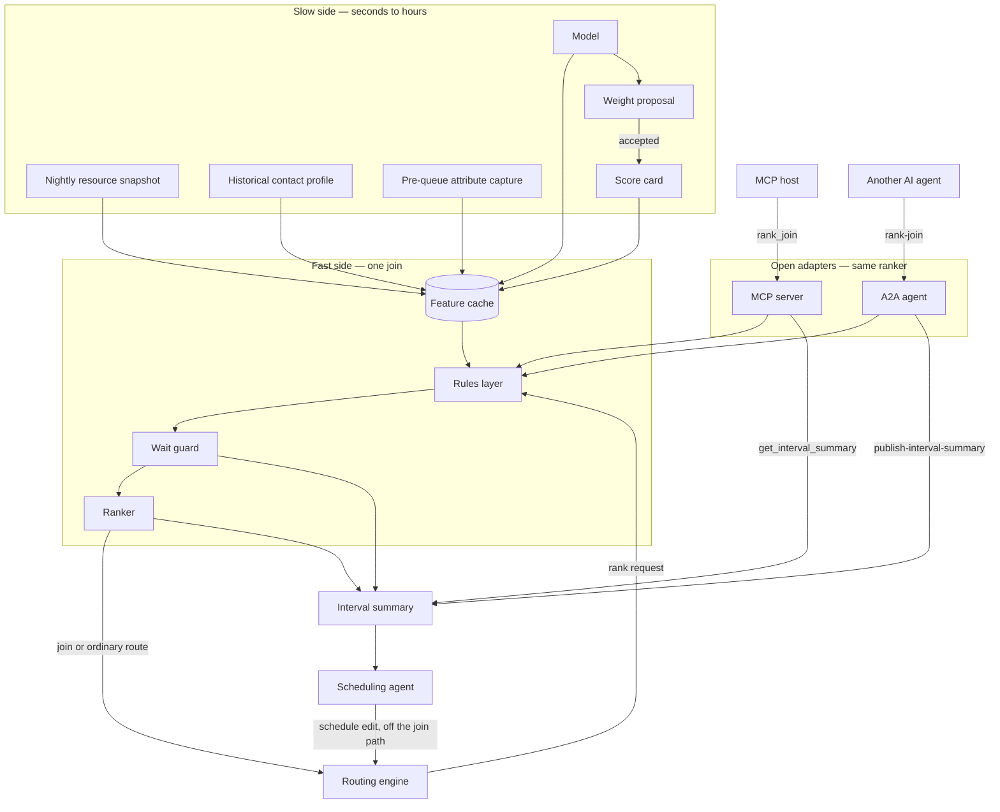
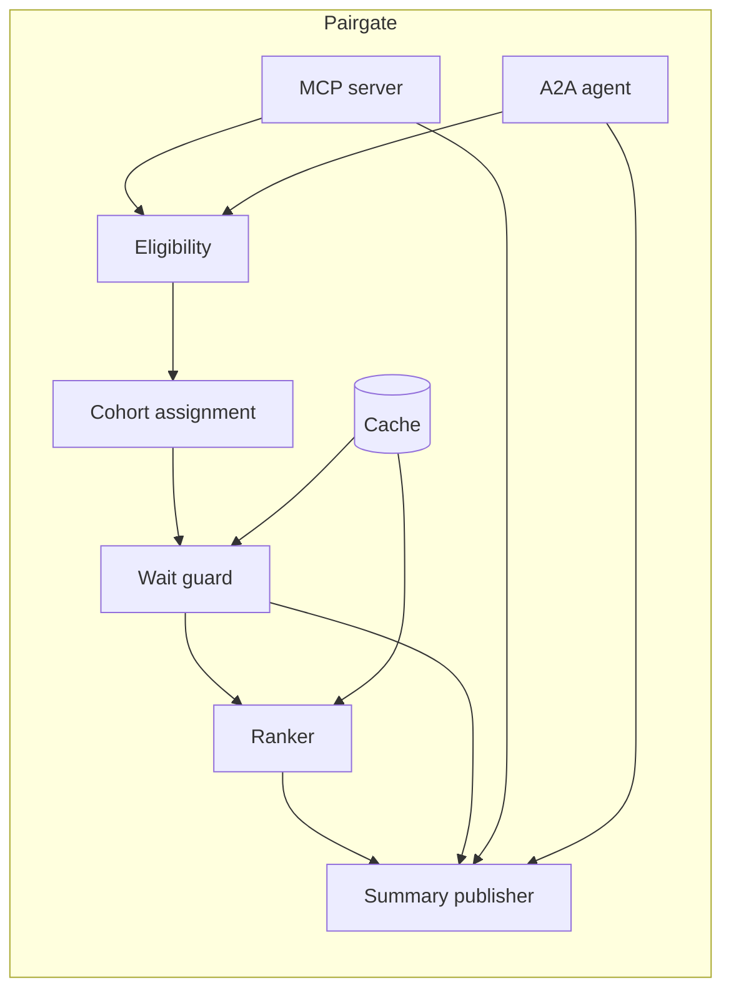
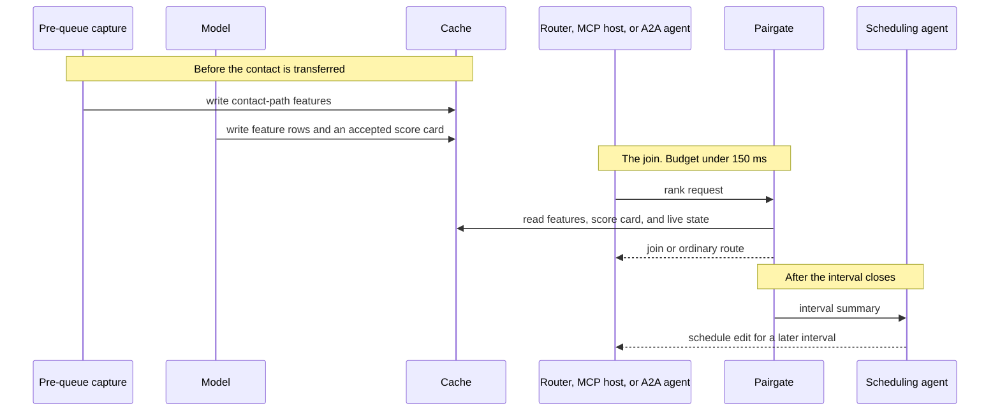
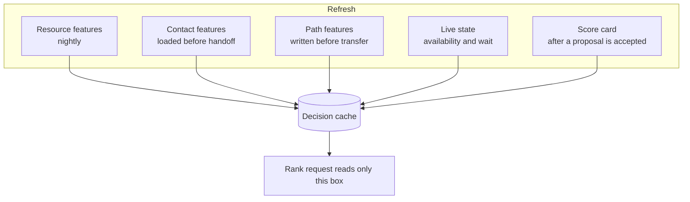
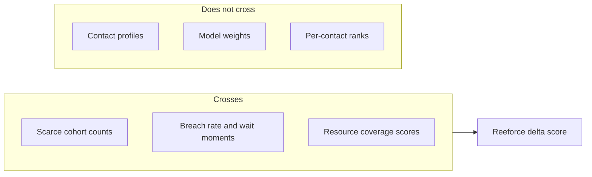
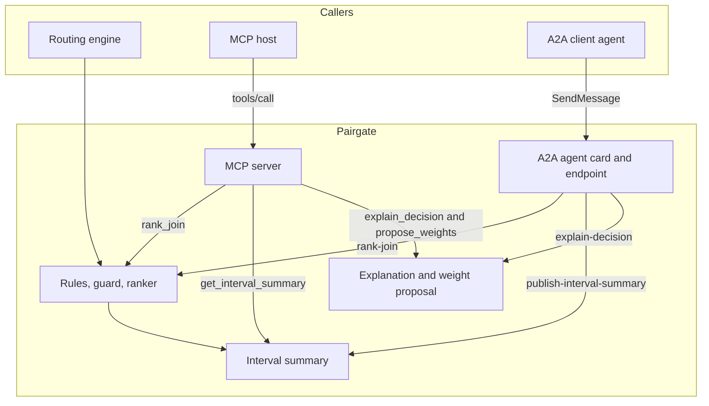
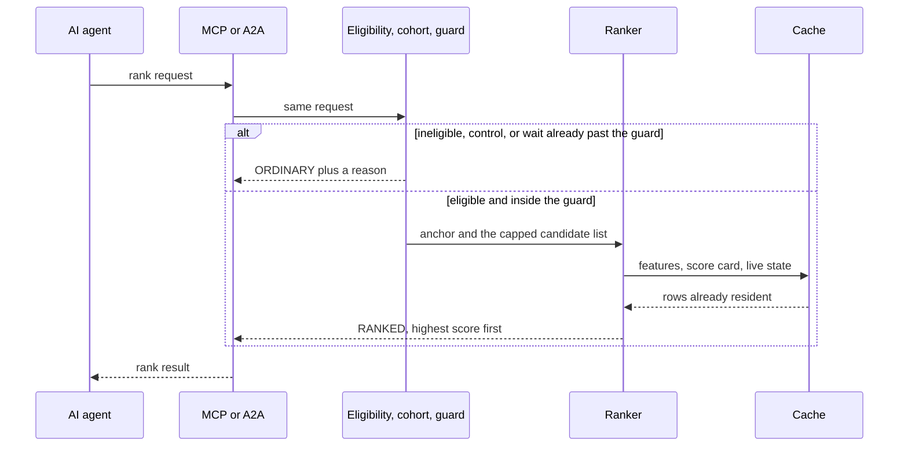
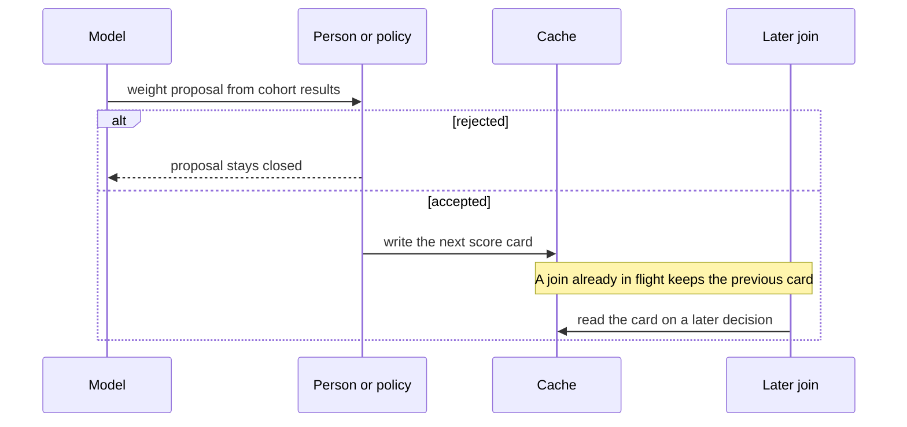

# Architecture

Pairgate is a join ranker with a slow side and a fast side. The slow side refreshes features and may accept a model's score card. The fast side only reads the cache, applies rules, and returns one rank or an ordinary-route order.

Other users and other AI agents reach that same fast side through two open protocols. An MCP host calls tools. An Agent2Agent client reads the agent card and sends a task. Neither protocol gets its own ranker.

Reeforce, or any other scheduling agent, sits beside it on a different clock. It reads an interval summary. It never sits on the join path.

## System context



The routing engine remains the system of record for who is in which state. Pairgate does not own agent state. It consumes a live view of availability and wait, ranks, and returns a decision the engine can apply. Extracting state out, deciding, and pushing the decision back through a slow event stream is the failure mode this design refuses: a late decision is applied to a pool that has already changed, and the next decision is wrong because the first one was late.

## Components



| Component | Responsibility | Not responsible for |
|-----------|----------------|---------------------|
| Eligibility | Call-type and line-of-work allow list. A small exclusion set, not a second policy language. | Model weights |
| Cohort assignment | Sticky matched vs control flag for measurement | Changing the objective |
| Wait guard | Breach test from the live wait distribution | Ranking |
| Ranker | Score candidates for one anchor from the live score card | Holding contact profiles outside the cache, or calling a model |
| Cache | Serve feature rows, live state, and the live score card | Training, and applying a proposal that is still open |
| Summary publisher | Aggregate the interval for a scheduling agent | Proposing `MOVE_MEAL` |
| MCP server | Tools for rank, summary, explanation, and weight proposal | A second ranker, or a path around the wait guard |
| A2A agent | Agent card and delegated tasks for those same four operations | A second ranker, or a schedule edit |

Intended modules, when code lands:

| Module | Role |
|--------|------|
| `pairgate-model` | Rank request, rank result, interval summary, score card, weight proposal |
| `pairgate-rules` | Eligibility, cohort, guard |
| `pairgate-rank` | Score function and candidate cap. Reads the cache only. |
| `pairgate-summary` | Roll the interval into the scheduling contract |
| `pairgate-mcp` | MCP tools and resources over the same ranker |
| `pairgate-a2a` | Agent card and `SendMessage` over the same ranker |

## Two clocks



Schedule edits apply to a future interval. They are not a way to fix a join that is already late.

## Feature cache



If a resource has no feature row, the rules layer takes the documented fallback (treat as ordinary route for that candidate, or for the decision, according to line-of-work policy). The ranker does not block on a fetch.

## What crosses the Reeforce boundary



Reeforce already knows the roster id. `resourceCoverage[].resourceId` uses that id so a `MOVE_MEAL` can name the same person the gap board names. See [reeforce-contract.md](reeforce-contract.md).

## Open interfaces

Other users and other AI agents call this same ranker. They do not import the repository and they do not receive a second scoring path. Two protocols front the process.



| Call | Protocol | Name | Clock |
|------|----------|------|-------|
| Rank one join | MCP `tools/call` | `rank_join` | Inside the join budget. Cache and arithmetic only. |
| Rank one join | A2A `SendMessage` | skill `rank-join` | Same ranker, same budget. |
| Read the closed interval | MCP | `get_interval_summary` | After the interval. No contact profiles and no weights. |
| Read the closed interval | A2A | skill `publish-interval-summary` | Same artifact a scheduling agent already uses. |
| Explain a finished join | MCP | `explain_decision` | After the join. A model may narrate. |
| Explain a finished join | A2A | skill `explain-decision` | Same explanation. The routing engine does not call it while someone is waiting. |
| Suggest new weights | MCP | `propose_weights` | Slow side. Status stays `PROPOSED` until accepted. |

An MCP host learns the tools from the server. An A2A client learns the skills from `/.well-known/agent-card.json` and sends JSON-RPC `SendMessage` to the interface URL in that card. Both envelopes carry the same rank request. The A2A data part adds `skillId` so the agent does not infer the task from prose. Pairgate runs the routing decision and returns the same rank result on either protocol.

## What an agent sends, and what comes back

Another AI agent does not describe the join in prose and hope for a match. It sends one rank request. Pairgate answers with one rank result. The agent applies the first id in `orderedCandidateIds` when `disposition` is `RANKED`. Any other disposition means the agent keeps its own ordinary route (longest idle, next in line) and does not retry.



The request names the decision, which side of the surplus this is, the line of work, the anchor, and the candidate pool. `anchorId` is the arriving contact when `direction` is `AGENT_SURPLUS`, and the person who just became free when `direction` is `CONTACT_SURPLUS`. `candidateIds` is the pool to rank: available people, or waiting contacts. The pool stays capped (100–200 people, or 70–100 contacts).

```json
{
  "decisionId": "d-1842",
  "direction": "AGENT_SURPLUS",
  "lineOfWork": "care",
  "anchorId": "contact-1842",
  "candidateIds": ["resource-14", "resource-22", "resource-7"],
  "issuedAt": "2026-10-10T23:40:00Z",
  "cohort": "MATCHED"
}
```

On MCP that object is the `arguments` of `tools/call` for `rank_join`. On A2A it is the JSON data part of `SendMessage` for skill `rank-join`, with `"skillId": "rank-join"` added beside those fields.

Pairgate then decides. Eligibility rejects a contact type that is outside the line of work. A control cohort is recorded and not ranked, so measurement still has an ordinary-route group. The wait guard forces an ordinary route when the wait is already past the threshold, so ranking cannot hold someone at the back of the queue. Everyone else is scored from the cache. The score uses the live score card and feature rows already in memory. No model runs on this call.

The result comes back on the same call. MCP puts it in `structuredContent`. A2A puts it in the completed task's artifact data part.

```json
{
  "decisionId": "d-1842",
  "disposition": "RANKED",
  "reason": "RANKED",
  "orderedCandidateIds": ["resource-22", "resource-14", "resource-7"],
  "scores": [
    { "candidateId": "resource-22", "score": 0.86 },
    { "candidateId": "resource-14", "score": 0.41 },
    { "candidateId": "resource-7", "score": 0.22 }
  ],
  "guardThresholdSeconds": 96.4
}
```

| `reason` | What the calling agent does |
|----------|------------------------------|
| `RANKED` | Offer `orderedCandidateIds[0]` if that candidate is still in the pool. |
| `INELIGIBLE` | Ordinary route. This contact type is outside matching. |
| `CONTROL` | Ordinary route. This contact is in the measurement group. |
| `BREACH` | Ordinary route. The wait guard already fired. |
| `EMPTY_POOL` | Ordinary route. There was nobody left to rank. |
| `NO_SCORES` | Ordinary route. The cache had no score for this pool. |

A result that misses the join budget is treated as ordinary too. The pool has moved, and applying a late order would poison the next decision. The summary and the explanation are separate calls. They are not the routing answer.

## Where the model sits



The model may also fill feature rows on the slow side. It does not load during the rank, and it does not see contact profiles in a weight proposal. Accepting a proposal does not reshuffle the people waiting right now.

## Deployment shape

The ranker, the rules layer, the cache client, and the MCP and A2A adapters run next to the routing engine's decision point. The adapters are how another project reaches the ranker. Training, nightly snapshots, and weight acceptance run elsewhere. Adding a remote call to the rank path requires a latency note; see [latency.md](latency.md).

The adapters in this repository are the Python modules under `python/pairgate`. Both call `decide`. An agent does not send feature rows. Those are loaded into the decision cache before the join, from a JSON file named by `PAIRGATE_CACHE`.

```bash
PYTHONPATH=python PAIRGATE_CACHE=python/decision-cache.example.json python3 -m pairgate.mcp_server
PYTHONPATH=python PAIRGATE_CACHE=python/decision-cache.example.json PAIRGATE_PORT=8080 python3 -m pairgate.a2a
```

The MCP process speaks stdio and answers `tools/call` for `rank_join`. The A2A process serves `/.well-known/agent-card.json` and `POST /a2a/v1` with method `SendMessage`. The body of either call is the rank request. The body of the response is the rank result.
