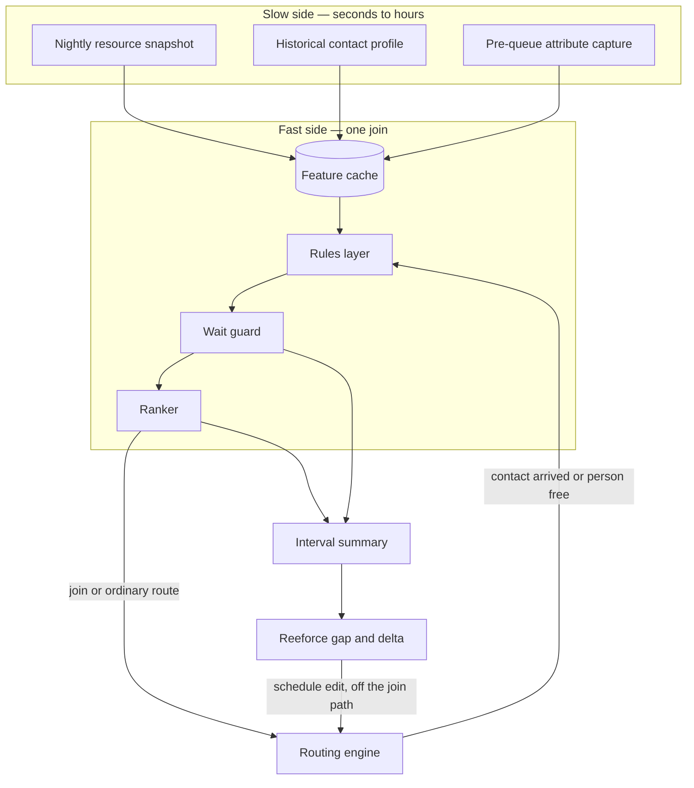
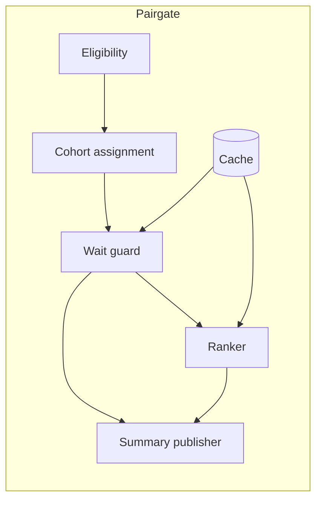
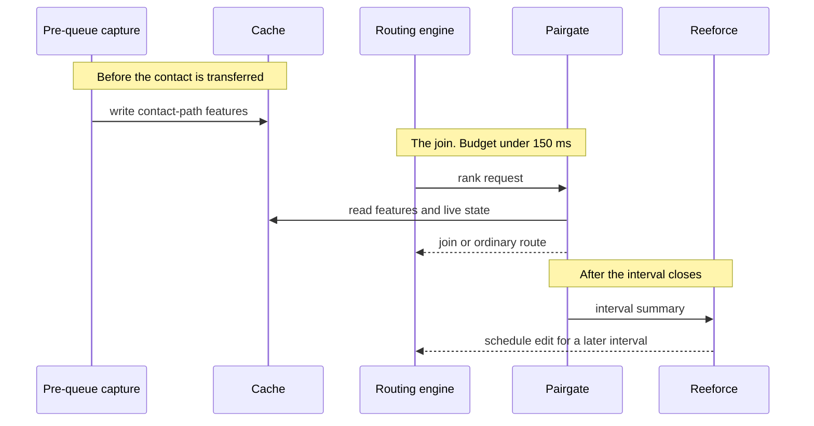
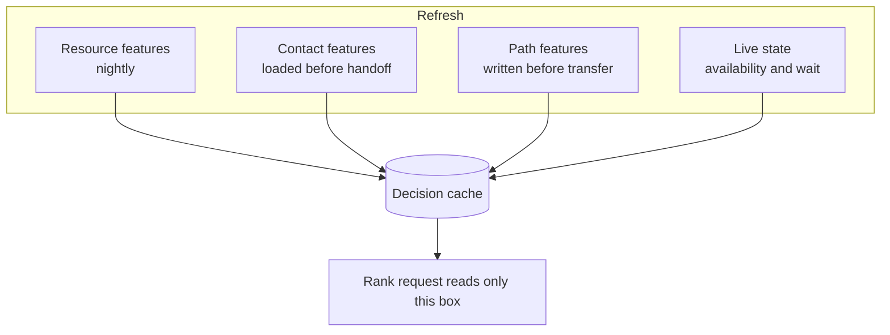
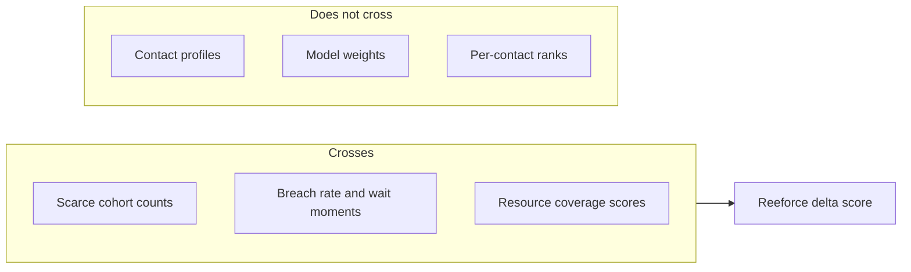

# Architecture

Pairgate is a join ranker with a slow side and a fast side. The slow side refreshes features. The fast side only reads the cache, applies rules, and returns one rank or an ordinary-route order.

Reeforce sits beside it on a different clock. It reads an interval summary. It never sits on the join path.

## System context

The routing engine remains the system of record for who is in which state. Pairgate does not own agent state. It consumes a live view of availability and wait, ranks, and returns a decision the engine can apply. Extracting state out, deciding, and pushing the decision back through a slow event stream is the failure mode this design refuses: a late decision is applied to a pool that has already changed, and the next decision is wrong because the first one was late.

## Components

| Component | Responsibility | Not responsible for |
|-----------|----------------|---------------------|
| Eligibility | Call-type and line-of-work allow list. A small exclusion set, not a second policy language. | Model weights |
| Cohort assignment | Sticky matched vs control flag for measurement | Changing the objective |
| Wait guard | Breach test from the live wait distribution | Ranking |
| Ranker | Score candidates for one anchor | Holding contact profiles outside the cache |
| Cache | Serve the four feature sets at decision time | Training |
| Summary publisher | Aggregate the interval for Reeforce | Proposing `MOVE_MEAL` |

Intended modules, when code lands:

| Module | Role |
|--------|------|
| `pairgate-model` | Rank request, rank result, interval summary |
| `pairgate-rules` | Eligibility, cohort, guard |
| `pairgate-rank` | Score function and candidate cap |
| `pairgate-summary` | Roll the interval into the Reeforce contract |

## Two clocks

Schedule edits apply to a future interval. They are not a way to fix a join that is already late.

## Feature cache

If a resource has no feature row, the rules layer takes the documented fallback (treat as ordinary route for that candidate, or for the decision, according to line-of-work policy). The ranker does not block on a fetch.

## What crosses the Reeforce boundary

Reeforce already knows the roster id. `resourceCoverage[].resourceId` uses that id so a `MOVE_MEAL` can name the same person the gap board names. See [reeforce-contract.md](reeforce-contract.md).

## Deployment shape

The ranker, the rules layer, and the cache client run in one process next to the routing engine's decision point. Training, nightly snapshots, and the interval publisher run elsewhere. Adding a remote call to the rank path requires a latency note; see [latency.md](latency.md).
