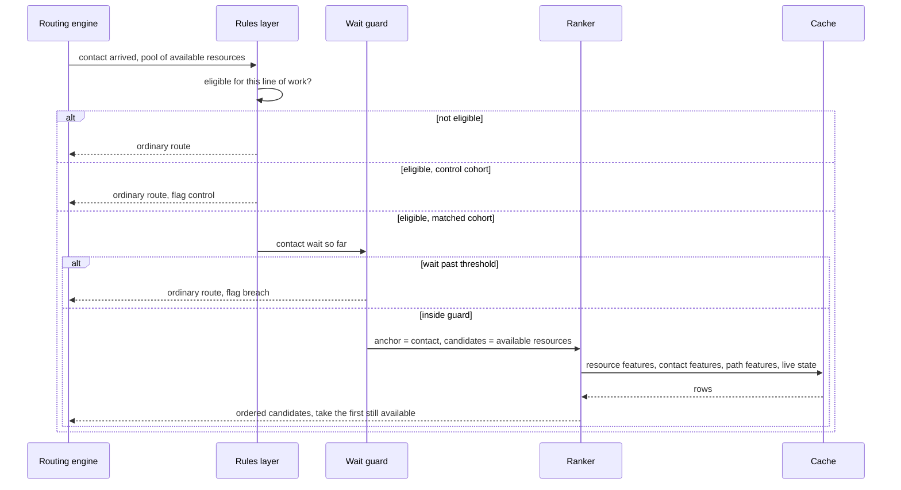
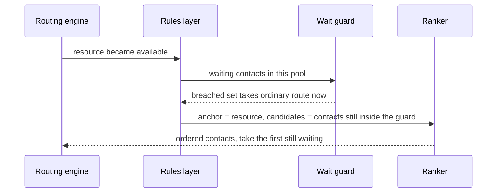
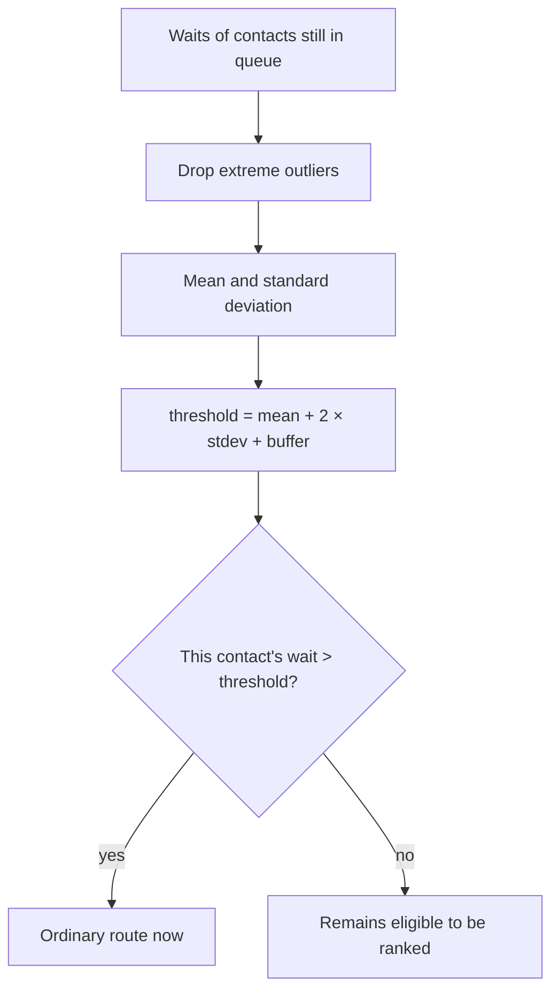
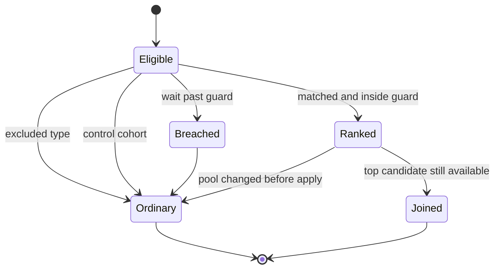

# Decision flow

Every join is one of two rankings. The rules around the ranking are the same in both directions.

## Agent surplus

A contact arrives. People are waiting for work. Rank the available people for this contact and offer the best.

Candidate cap: 100–200 available people. If the pool is larger, the routing engine supplies the eligible subset (skill group or queue), not the whole site.

## Contact surplus

A person becomes free. Contacts are waiting. Rank those contacts for this person, then drop anyone the wait guard has already breached.

Candidate cap: the first 70–100 waiting contacts by arrival, after eligibility. The guard runs before ranking so a breached contact is not held for a better score.

## Eligibility

Eligibility is a property of the contact type, decided before ranking.

- Included types go through the flow above.
- Excluded types always take the ordinary route.
- The exclusion set is small. If it needs a general rules language, that is a sign the line of work should be a separate objective, not a larger predicate.

## Cohort

Matched and control contacts share the same path, the same cache, and the same guard. Ranking is off for control. Each contact is flagged `MATCHED` or `CONTROL` on the disposition so outcome per contact can be compared later.

Assignment is sticky for the life of the contact. Re-ranking after a transfer does not flip the cohort.

A typical operating split is 80% matched and 20% control. The split is policy, not a constant in the ranker.

## Wait guard

The buffer is configured per line of work. Sixty seconds is the default starting point. The guard is recomputed from the live queue, not from yesterday's service level.

## Objectives

The ranker scores with the weights configured for the line of work. Those weights are data.

| Line of work shape | What usually dominates | Watch metrics |
|--------------------|------------------------|---------------|
| Value-seeking care | Outcome value | First-contact resolution, transfers, handle time |
| Technical assistance | First-contact resolution | Handle time, transfers |
| Recovery or collections | Its own objective | Defined when that line is onboarded |

A new line of work is an explicit configuration: which attributes are in the payload, and the weights. It is not a fork of the ranker.

## Result

`pool changed before apply` is the snowball case. If availability moved during the decision, the result is discarded and the contact takes the ordinary route. The ranker does not retry inside the same request. Retrying on a stale pool is how a short delay becomes a cascade.
