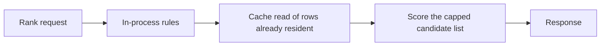
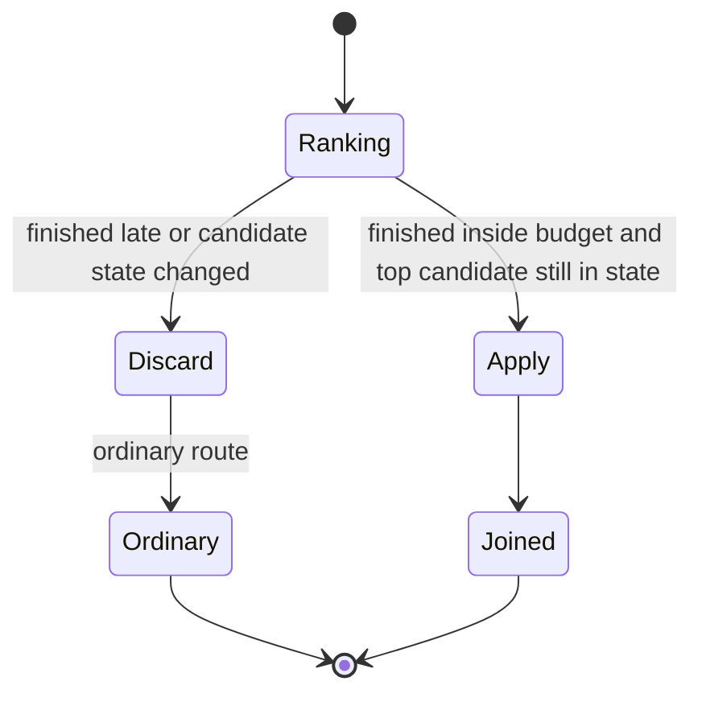

# Latency

A join decision that lands after the pool has changed is worse than an ordinary route. Pairgate treats lateness as incorrectness, not as a slow success.

## Budget

| Path | Budget | What is inside it |
|------|--------|-------------------|
| Agent surplus, end to end | about 70 ms | Rules, cache read, rank, return |
| Contact surplus, end to end | under 150 ms | Guard over the waiting set, then rank |
| Live-state freshness | tens of milliseconds, not hundreds | Availability and wait used by the decision |

These are design targets for a co-located decision, not a promise about any particular deployment. A path that takes seconds is out of policy. At that delay the pool has moved, the next decision reads the wrong availability, and errors pile up. The recovery is to discard the late result and take the ordinary route, not to apply it.

## Allowed on the join path

- Eligibility, cohort, and the wait-guard arithmetic.
- Reads of resource features, contact features, path features, and live state that are already in the decision cache.
- Scoring a capped candidate list (100–200 people, or 70–100 contacts).

## Not allowed on the join path

- Fetching a profile from a warehouse or an object store.
- Training, feature generation, or a model load.
- Publishing the Reeforce interval summary.
- Waiting for a schedule edit from Reeforce.
- Retrying the rank against a pool that changed mid-request.

Nightly resource snapshots and historical profiles are written into the cache before the operating day, or before the contact is transferred. Pre-queue attributes are written before the transfer completes. If they are not in the cache, the rules layer uses the fallback. It does not go and get them.

## Freshness versus rank time

Most of a slow integration is not inference. It is finding out who is free. If availability events arrive late, the ranker honestly ranks a stale pool, and the snowball starts. Pairgate assumes the live-state feed is fresh inside the budget above. Making the feed fresh is a property of how the routing engine exposes state, not a reason to add hops after the rank.

## Discard rule

One discarded decision is a single ordinary route. Applying a late decision is a bad join plus a lie in the next decision's live state.
