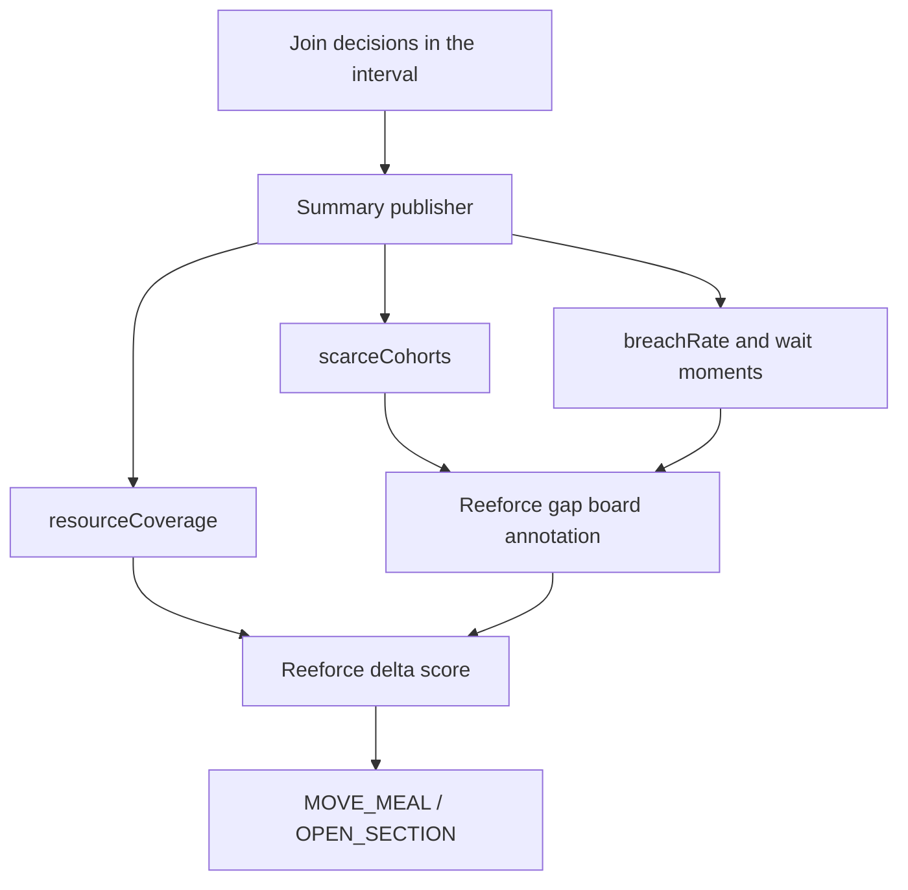
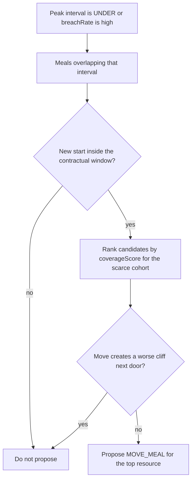

# Reeforce contract

Reeforce plans the next interval. Pairgate decides the next join. This page is the only supported coupling.

Reeforce repository: [vikas-prasad-cx/reeforce](https://github.com/vikas-prasad-cx/reeforce).

## What Reeforce already does

For the contact-center domain, Reeforce turns a demand series into required headcount, turns the roster plus adherence into available headcount, and emits a gap board. A positive gap is `UNDER`. The delta engine then proposes one small edit, most often `MOVE_MEAL` inside a contractual window, or `OPEN_SECTION` when overflow capacity exists.

That edit is scored as "one more person on the peak." Pairgate adds a second score: "the person the scarce arrivals can actually use."

## Interval summary

Published at the end of each staffing interval, or on a shorter cadence if breach rate moves faster than the interval. Schema: [../spec/interval-summary.schema.json](../spec/interval-summary.schema.json).

| Field | Reeforce use |
|-------|----------------|
| `scarceCohorts[].arrivalShare` | Share of arrivals that need this cohort. High share plus low `capableAvailable` is an affinity gap. |
| `scarceCohorts[].capableAvailable` | People on the floor who score well for that cohort. Compared with Reeforce `available`, which counts everyone. |
| `breachRate` | Contacts forced to the ordinary route by the wait guard. A high rate with a small headcount gap means the mix is wrong. |
| `meanWaitSeconds`, `guardThresholdSeconds` | Context for the breach rate. Not a new service-level formula inside Reeforce. |
| `resourceCoverage[].resourceId` | Roster id. The same id `MOVE_MEAL` already prints. |
| `resourceCoverage[].coverageScore` | Expected share of scarce arrivals this person would rank first for. |

## How a meal move changes

Today, trust a `MOVE_MEAL` when the meal overlaps an `UNDER` interval, the new start stays inside the window, and the move does not create a worse cliff next door.

With a summary, add two checks:

1. Among resources on a meal that overlaps the peak, prefer the highest `coverageScore` for the scarce cohort with the worst `capableAvailable` gap.
2. If `breachRate` is high and the headcount gap is near zero, still consider the move. The board's `ok` flag is not sufficient when the wait guard is firing.

`OPEN_SECTION` uses the same coverage idea when overflow resources carry a cohort. Opening a spare seat that cannot serve the scarce cohort does not close an affinity gap.

## What Reeforce must not do

- Call the ranker while painting the gap board. The summary is an input, like the demand CSV.
- Re-rank contacts as a side effect of a delta. The schedule edit lands in a later interval; the routing engine and Pairgate handle joins.
- Store contact profiles. If a field is not in the interval schema, it does not belong in the Reeforce dataset.

## Learn step

Reeforce's learn step asks which edit closed the cliff. Pairgate adds a second question, answered from the matched-versus-control flags already on dispositions:

- Did `peak_gap` fall?
- Did the matched cohort's primary outcome move relative to control in the intervals after the edit?

An edit that only cuts `peak_gap` is still valid. It is recorded as a headcount fix, not a match fix. That keeps the two products honest about what each one changed.
