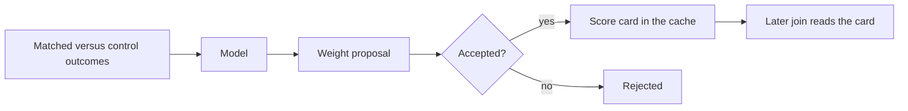

# Scoring

A model makes Pairgate better by writing the cache before the join, not by sitting inside it. The join path reads a [score card](../spec/score-card.schema.json) and feature rows that are already numbers between 0 and 1. It returns a weighted score. Loading a model, calling one, or waiting for a proposal is outside the [latency budget](latency.md).

## Two documents

| Document | Status | Who writes it | Who reads it on the join |
|----------|--------|---------------|--------------------------|
| Score card | Live for that line of work | Slow side, after a proposal is accepted | The ranker |
| [Weight proposal](../spec/weight-proposal.schema.json) | `PROPOSED` until a person or a policy accepts it | A model, from matched-versus-control results | Nobody |

A proposal carries the line of work, the suggested weights, a reason, and the cohort outcomes that motivated it. It does not carry contact profiles. Accepting a proposal does not reshuffle anyone waiting right now. The slow side writes the next score card, and a later join reads it.

## Baseline score

For one candidate, with feature values `v` already in the cache and weights `w` from the score card:

```text
score = sum(w_i * v_i) / sum(w_i)
```

The sum skips a feature the candidate does not have, and drops that weight from the denominator. If the candidate has none of the weighted features, that candidate is unscored. If nobody in the pool is scored, the decision is an ordinary route with reason `NO_SCORES`, and the routing engine uses its own fallback (longest idle, next in line).

Weights are positive. A higher feature value is better for that objective. A line of work that needs the opposite encodes the feature so that 1 is the desired end before the value reaches the cache. The ranker does not know the line of work's story. A care line, a technical line, and a collections line differ only by the weights and the feature rows their teams place in the cache.

Ties break by candidate id, ascending, so the same cache returns the same order.

## Where a model fits



The model may also fill feature rows on the slow side: nightly for resources, before transfer for a contact, during the pre-queue dialogue for path features. Those rows are the same four inputs the [architecture](architecture.md) already names. The new piece is that a model is allowed to propose the weights, and is not allowed to be called while the rank is in flight.

`modelId` on the score card is recorded with the decision so a later explanation can say which objective was live. The join path does not use that id to fetch anything.

## Next contributions

- A slow-side job that turns an `ACCEPTED` proposal into a score card and refuses a `PROPOSED` one.
- A model adapter that emits a weight proposal from cohort outcomes and never receives contact profiles.
- A replacement for the baseline formula that still reads only the cache and still returns a score in 0–1.
